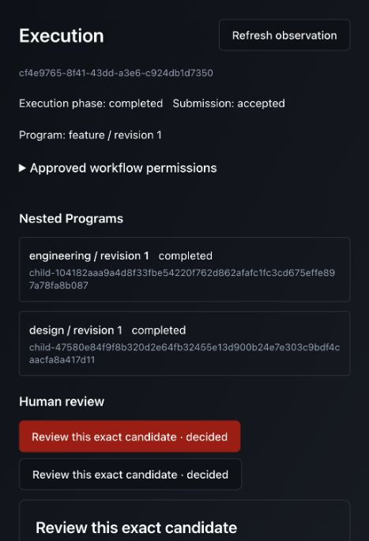
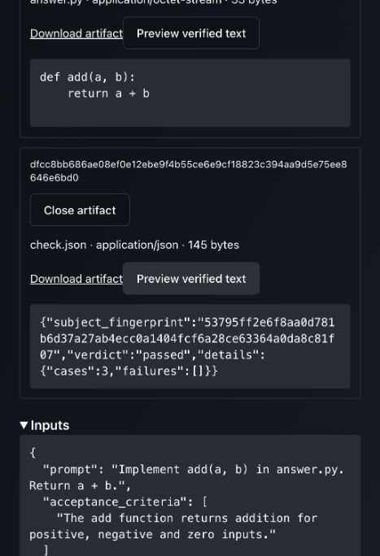

# Live Codex feature journey through the actual App

Recorded 2026-11-06. This extends [the live HTTP checkpoint](2026-11-06-content-handoff.md)
with actual browser invocation, design approval, final candidate inspection,
approval and fresh retrieval after compute removal. It proves the execution slice,
not full authoring, the unified canvas, Git delivery or overall platform acceptance.

## Ownership and placement

The production App, API, signed-cookie admission, saved encrypted resources,
published Programs, managed capabilities and production verifier are exercised.
External identity and the design proposal are controlled fixtures. Review decisions
were entered manually through the actual UI; coding uses the real Codex CLI/model.

The Local execution host coordinates Feature revision 1. Its pinned Design and
Engineering revision-1 children use normal Program calls. The saved coding resource
selects the `coding` profile, dispatching Codex to an externally owned OpenShell
sandbox. Artifact loading/publication uses trusted local `thread` placement; bounded,
verified content crosses the coding boundary without a storage credential. The
separately owned Python verifier dispatches evaluation to OpenShell with networking
disabled. Python evaluation is explicitly disabled in the API host. Receiver-only
Codex sandbox mode is `danger-full-access` inside the external sandbox; this is not
strict Landlock or Codex's nested filesystem isolation. The selected outer OpenShell
policy remains active. This run is not a Temporal or Kubernetes acceptance claim.

The host test composition now shares identity/assets/cookie/database lifetime
between controlled and live browser runners. `support.live_feature` shares the
live coding/check setup with the HTTP test. A local fixture marker releases only
owned compute after checking the owned root's exact Program and terminal phase;
the artifact API remains available. There is no new product execution-control API.
The CLI rejects missing `--live-coding` before reading the private provider binding.

## Commands and focused checks

From `ui/`:

```sh
NODE_ENV=production node tests/build-placement-browser.mjs /tmp/unifai-live-feature-browser-assets
```

Build completed in **4.99s**, with 4,563 modules. Existing circular vendor and large
chunk warnings remain. Workspace asset: `workspace-browser-CdfussQQ.js`.

From the repository root, with the existing authorized ignored credential binding:

```sh
UNIFAI_TEST_MONGO_URI=mongodb://127.0.0.1:27018 \
UNIFAI_TEST_REDIS_URI=redis://127.0.0.1:6380/15 \
UNIFAI_TEST_OPENSHELL_ENDPOINT=127.0.0.1:8090 \
UNIFAI_TEST_OPENSHELL_PKI="$PWD/multi-agent/tests/infra/.state/openshell-20261105/pki" \
UNIFAI_TEST_OPENSHELL_IMAGE=unifai-codex:content-handoff-20261106 \
PYTHONPATH=multi-agent/tests:multi-agent/lib:multi-agent/adapters:multi-agent:multi-agent/plugins \
.venv/bin/python -m support.live_feature_browser \
  --assets /tmp/unifai-live-feature-browser-assets \
  --directory /tmp/unifai-live-feature-browser-run-20261106 \
  --backend openshell --live-coding
```

The runner printed `http://127.0.0.1:52389/fixture/feature-login`; no private cookie
was printed. The process handle was retained until terminal cleanup (exit 0).

Before the browser gate, the profile and fixture lifetime tests passed:

```sh
.venv/bin/python -m pytest \
  multi-agent/tests/adapters/test_candidate_profiles.py \
  multi-agent/tests/adapters/test_live_browser_lifetime.py -q \
  -o addopts='--tb=short --strict-markers --import-mode=importlib' -p no:cacheprovider
```

**8 passed in 0.81s.** Release tests reject active roots, unrelated Programs, child
executions and denied observations; only the owned completed root releases compute.
Ruff check/format passed the seven changed host fixture/test files. Installed
execution source stayed frozen. The earlier shared/native/paid HTTP gates were not
rerun for host-only fixture changes.

## Browser acceptance

Root: `cf4e9765-8f41-43dd-a3e6-c924db1d7350`, Feature revision 1.
Task: `Implement add(a, b) in answer.py. Return a + b.` Criterion covers positive,
negative and zero inputs. Through schema fields, selected artifact read/publish in
`engineering` and `verification-reports`, maximum 65,536 bytes; review `release@1`
open/read/close; verification `engineering@1` create/read/run_check. All three leases
were 3,600 seconds. Explicitly approved those permissions and invoked through UI.

Before design approval the root showed only the Design child. Inspected and approved
design revision 1 through the shared review fields. Engineering then appeared as
an observed child. Real Codex produced the candidate on its first attempt; no live
repair occurred. Native and controlled repair coverage remains separately recorded.
Inspected the exact final artifact and verified text before approving final review.
Root, Design and Engineering subsequently showed completed; result was `verified`.

| Output | Artifact ID | SHA-256 | Bytes |
| --- | --- | --- | --- |
| `answer.py` | `62730641311c42e8dfbfbcfafdd8b399409b8f4e92c88f1a19fd4310c37a0d04` | `4ba6c8881970c15c36e02f5784c3ea2713b519d51b02afdaf39c13e3e95189da` | 33 |
| `check.json` | `dfcc8bb686ae08ef0e12ebe9f4b55ce6e9cf18823c394aa9d5e75ee8646e6bd0` | `8dbc9dada2e29fe7e8e3244eb18cd940f6963d81d83510b4c97b86543250d732` | 145 |

The independent report has `verdict: passed`, `details.cases: 3` and
`details.failures: []`, bound to the exact candidate fingerprint. The source is
`def add(a, b):\n    return a + b\n\n`.

After completion, wrote the root ID to the runner's local `release-compute` marker.
The runner reported owned compute removed while the API remained available. Reloaded
the execution page, reopened both cards and freshly retrieved their verified previews.
This is not a cached preview left open across cleanup.





Read-only API/Mongo inspection additionally confirmed one completed private verifier
execution, one recorded passing check for this root/candidate, and owner HTTP 403
on the private verifier. All three managed capability records were retired with
zero cleanup-pending rows or remaining credential fields; no credential JSON files
remained. The API-host source workspace never existed. Audited decoded source,
report, public result, three published revisions and fixture API/identity/publication
logs for the real provider key using constant failure diagnostics; the audit passed.
This bounded audit is not a claim about every possible secret path.

Closed the owned tab and stopped the runner once. It removed database
`unifai_feature_browser_a8caec92efae415a95818e8957e71a91`. Verified database absence,
cookie/workspace absence, identity shutdown and the API no longer listening.
`docker ps -a --filter ancestor=unifai-codex:content-handoff-20261106` returned no
containers, including stopped receivers. Shared services and images were retained.

## Source, scope and next work

[Focused source manifest](2026-11-06-live-feature-ui-source.json) records current
host fixtures, selected production/UI contracts, browser assets and screenshots.
Its 49-file aggregate is `0ccf4740826216b52b7cd1467187122e02b9dcd31ec0323b2bdf1f23006add40`.
Receiver image: `unifai-codex:content-handoff-20261106`, identity
`sha256:94fbdffd48efff2e39a1098fcf5b150d80296d377a5a8e72bddf7cb4bb10ccaa`;
parent sandbox identity `sha256:cd0a96ee7401c3813069381ccbbefe6e583e535fcb556f278da4b295ef994fdf`.
Earlier runtime comparison matched 1,283 production/runtime Python files per image;
selected exercised production files remained unchanged. The current host-only
browser helpers postdate the image's full test-fixture snapshot; do not claim every
current test fixture is installed in that image. No Run Engine changes were made;
baseline remains `60393440efd3876cd6c81e0b013e8bf6d9167659`.

This is a bounded normal-OpenShell live browser execution checkpoint, with
`gpt-5.4-nano`, 60 seconds/four command events per coding attempt and at most one
repair. These are not strict dollar/token budgets. Identity/design fixtures,
prepublished configuration and a small file are explicit limitations. Current
Programs authoring remains form-heavy, the graph editor is separate, and execution
shows panels/lists rather than the target unified live canvas. Full UI resource and
Program creation in the live journey, unchanged independent/nested revision reuse,
configurable completion alternatives, Git/CI/Jira delivery, live design generation,
Session/occurrence views, remote/recovery/load and the remaining checklist stay open.
