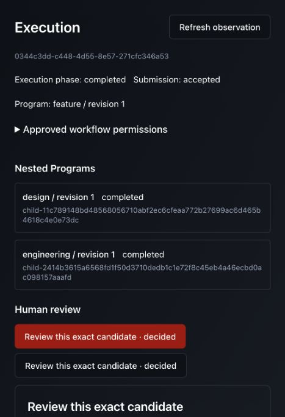
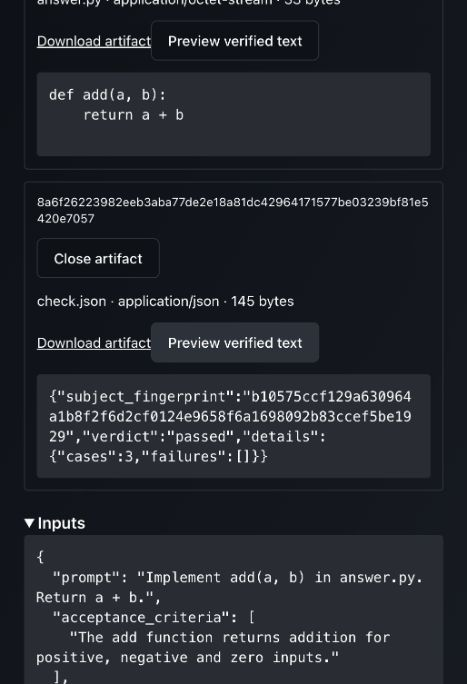

# Configurable coding-agent designer and live design-to-delivery journey

Recorded 2026-11-07 (local date). This replaces fixture proposal generation in the
live feature composition with an ordinary production Program. It is a bounded
Local/OpenShell browser checkpoint, not complete authoring or platform acceptance.

## Implementation and responsibilities

`mas_plugins.engineering.designer` registers `coding_designer@1` with typed input,
output and configuration models. Users configure a captured coding-operation bundle,
artifact loader, coding placement and separate artifact placement through the normal
Program lifecycle. The implementation has no Codex/engine SDK dependency and adds
no compiler switch, scheduler, environment manager or graph-state requirement.

`CodingDesignWork` is a concrete installed specialization of generic `DesignWork` /
`FeatureRequest`, exposing `CodingInput` fields to schema-driven authoring while
preserving other designers' generic task contracts. It forwards the task, acceptance
criteria and recorded previous proposal/review response. Input files are staged as
bounded verified content. The agent's final JSON is validated as `DesignProposal`;
malformed JSON, empty plans and extra approval fields fail without exposing content.
JSON instructions guide generation; result validation establishes the contract.
This is not provider-enforced structured generation or proof of plan quality.

The existing Feature Design coordinator still owns numbering, revision bounds and
durable review. The designer neither approves work nor publishes implementation
evidence. Planning instructions are not an enforced read-only filesystem policy.
Its normal invocation owns an isolated workspace; placement/ownership remain with
Run Engine and the selected operator profile.

Extracted bounded file loading from the file candidate into application-owned
`ProgramFileInputs`, shared by both Programs. It depends on the narrow `ElementCalls`
part of the same `ProgramRuntime` contract, checks aggregate size before loading and
validates loaded content identity before forwarding inline files. Storage authority
stays on artifact placement. The old private candidate loader implementation is gone.

The native/shared live fixtures now save distinct designer and implementer resources
through `CodingResourceLibrary`, preserving protected bundle capture. The live
composition installs the production designer and no longer registers the fixture
designer. Controlled proposal peers remain useful in separate explicit tests.

## Verification

```sh
.venv/bin/python -m pytest multi-agent/tests/application multi-agent/tests/domain \
  multi-agent/tests/architecture -q \
  -o addopts='--tb=short --strict-markers --import-mode=importlib' -p no:cacheprovider
```

**786 passed in 7.14s**, including eight new designer checks and existing candidate,
design, composition and boundary tests. Strict mypy passes five affected production
modules: Program ports, shared file inputs, candidate, design and designer.
Ruff check/format passes the twelve affected production/test/helper files;
`git diff --check` passes.

```sh
UNIFAI_TEST_MONGO_URI=mongodb://127.0.0.1:27018 \
UNIFAI_TEST_REDIS_URI=redis://127.0.0.1:6380/15 \
.venv/bin/python -m pytest multi-agent/tests/integration/coding/test_feature_workflow.py \
  -q -o addopts='--tb=short --strict-markers --import-mode=importlib' -p no:cacheprovider
```

**2 passed in 28.47s**, thread and process. Real HTTP/Mongo/Redis and the production
CLI adapter use a controlled executable, not a model. Each scenario generates a
proposal, rejects it, regenerates with exact recorded feedback, approves revision 2,
then implements a failing candidate, independently checks it, restores source/report
inputs for repair, and accepts the verified candidate. Both designer invocations
receive the supplied README; no implementation candidate appears before approval.
Private homes, durable output, scoped authority and retirement are checked.

Two fixture setup issues were corrected before that final native gate: duplicate
saved-resource names, then a protocol peer treating the appended workspace-file
manifest as part of its JSON request. Distinct role names and decoding the first
JSON value fixed those issues; production limits/validation were not weakened.

The profile/browser-lifetime/CLI gate also passes **23 tests in 8.11s**:

```sh
.venv/bin/python -m pytest multi-agent/tests/adapters/test_candidate_profiles.py \
  multi-agent/tests/adapters/test_live_browser_lifetime.py \
  multi-agent/tests/integration/coding/test_codex_cli.py -q \
  -o addopts='--tb=short --strict-markers --import-mode=importlib' -p no:cacheprovider
```

## Matched images and actual App

Built the receiver with the existing pinned OpenShell base and then its Codex
derivative. Installed execution source stayed frozen throughout builds and the live
gate. No Run Engine changes were made; baseline remains
`60393440efd3876cd6c81e0b013e8bf6d9167659`.

```sh
docker build \
  --build-arg RECEIVER_BASE=ghcr.io/nvidia/openshell-community/sandboxes/base@sha256:aeef1c63f00e2913ea002ccb3aaf925f338b5c5d70e63576f0d95c16a138044e \
  --build-arg RECEIVER_USER=sandbox \
  --build-context unifai="$PWD" --build-context run_engine="$PWD/../run-engine" \
  --file multi-agent/tests/infra/Dockerfile.receiver \
  --tag unifai-sandbox:feature-designer-20261107 multi-agent/tests/infra
docker build --build-arg SANDBOX_IMAGE=unifai-sandbox:feature-designer-20261107 \
  --file multi-agent/tests/infra/Dockerfile.codex \
  --tag unifai-codex:feature-designer-20261107 multi-agent/tests/infra
.venv/bin/python multi-agent/tests/infra/verify_images.py \
  --image unifai-sandbox:feature-designer-20261107 \
  --image unifai-codex:feature-designer-20261107
```

Each image matches **1,400 Python files**, including shared fixtures; replaced paths
are absent. Identities are recorded in the focused manifest. CLI remains 0.166.0.
Selected UI source and built asset hashes still match the preceding browser build,
so no unchanged UI build or broad remote matrix was repeated.

```sh
UNIFAI_TEST_MONGO_URI=mongodb://127.0.0.1:27018 \
UNIFAI_TEST_REDIS_URI=redis://127.0.0.1:6380/15 \
UNIFAI_TEST_OPENSHELL_ENDPOINT=127.0.0.1:8090 \
UNIFAI_TEST_OPENSHELL_PKI="$PWD/multi-agent/tests/infra/.state/openshell-20261105/pki" \
UNIFAI_TEST_OPENSHELL_IMAGE=unifai-codex:feature-designer-20261107 \
PYTHONPATH=multi-agent/tests:multi-agent/lib:multi-agent/adapters:multi-agent:multi-agent/plugins \
.venv/bin/python -m support.live_feature_browser \
  --assets /tmp/unifai-live-feature-browser-assets \
  --directory /tmp/unifai-live-designer-browser-run-20261107 \
  --backend openshell --live-coding
```

Used the printed login URL on port 59369. Root:
`0344c3dd-c448-4d55-8e57-271cfc346a53`. Through the actual App, invoked Feature revision 1
with the small addition task, positive/negative/zero criterion and a verified 20-byte
inline `README.txt`. Used the supported JSON input editor. Explicitly selected
artifact read/publish in engineering/verification-reports (65,536 bytes), review
release@1 open/read/close and verification engineering@1 create/read/run_check;
all three leases were 3,600 seconds. Credentials remained privately provisioned.

Observed only the Design branch initially and followed its real designer child in
the shared execution hierarchy. Codex returned a 1,338-character implementation and
verification plan, including the README reference. Approved exact design revision 1
through the UI, then observed Engineering run. Real coding produced a candidate on
its first attempt; the separately owned offline OpenShell verifier passed three
cases. Real planning and coding use distinct saved resources on the coding profile;
artifact operations remain trusted local. No live revision or repair was needed.

Inspected source in the UI and independently retrieved the exact admitted check
report through authenticated HTTP before final approval. A read-only audit confirmed
the production designer child completed with the exact retained proposal and the
candidate owner receives 403 on the private verifier execution. Root result was
`verified`, design revision 1, one Engineering attempt.

| Output | Artifact ID | SHA-256 | Bytes |
| --- | --- | --- | --- |
| `answer.py` | `6aba9a38b9ff5b5c2e9f0c60924bd8f530d94decc6ae777bfdb69ff62a60da7f` | `4ba6c8881970c15c36e02f5784c3ea2713b519d51b02afdaf39c13e3e95189da` | 33 |
| `check.json` | `8a6f26223982eeb3aba77de2e18a81dc42964171577be03239bf81e5420e7057` | `bf3283fe59d88cd0a5d864a80b0426f71c1feb3f5ba9bd9f8d4b35894026a6cc` | 145 |

After completion, released owned compute using the fixture marker, reloaded the
execution URL and freshly retrieved both verified previews. The report contains
`details.cases: 3` and `details.failures: []`.





All three managed capabilities retired, with no credential fields or JSON files
remaining. The API-host source workspace never existed. Decoded source/report,
result, published revisions and owned API/identity/publication logs passed the actual
provider-key audit using constant diagnostics. This is a bounded audit, not proof of
every possible leak path. Closed the owned browser and stopped the same runner once
(exit 0). Verified unique database/cookie removal, API/identity shutdown and no
running or stopped receiver containers. Shared services/images were retained.

## Explicit gaps and next work

The pending final-review UI exposes the candidate but not its admitted report; the
report appears in the root result only after completion. The API audit above does
not establish pre-approval UI evidence access. Next: freeze the exact candidate and
verification snapshot in the ADLC review subject so the shared artifact inspector
can expose both before the decision. Preserve exact-version checks and generic HITL.

Programs/resources were prepublished through normal API fixtures, not created from
scratch in this browser journey. Complete user-created authoring, unified canvas,
completion alternatives, Git/CI/Jira delivery, Temporal/Kubernetes/recovery/load and
other checklist items remain open. The first full product milestone is not yet
accepted. External identity is controlled; model planning/coding and checks are real.
The configured 60-second/four-command limits are not strict monetary/token budgets.
Stronger kernel filesystem checks and hostile same-user credential isolation are
separate claims. Earlier unchanged-reuse evidence retains its own tested snapshot.

[Focused source and outcome manifest](2026-11-07-configurable-designer-source.json)
records current exercised files, images, proposal/output identities and screenshots.
