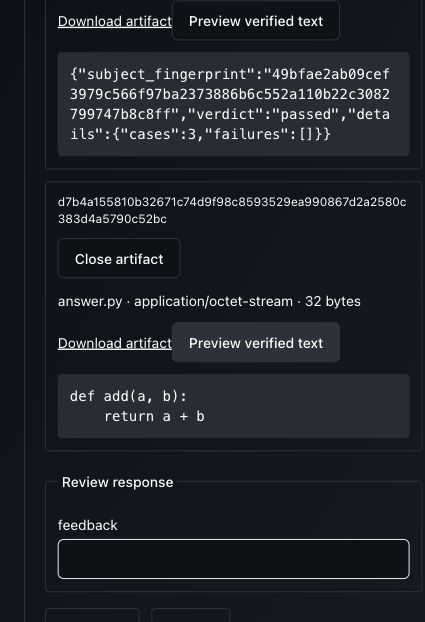
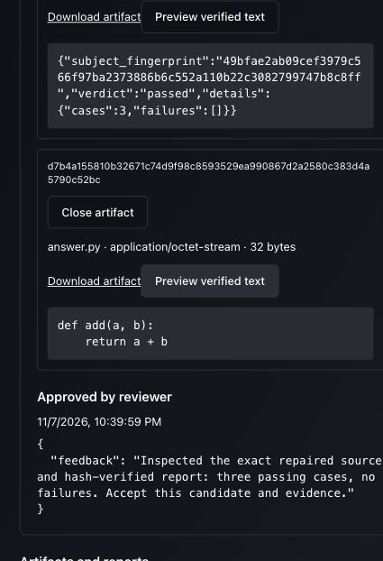

# Exact candidate and verification evidence before approval

Recorded 2026-11-07 against the worktree atop `f8469f88`. Source, support, built
App asset identities and the synthetic execution are recorded in the focused
[source manifest](2026-11-07-review-evidence-source.json). This advances the active
feature-delivery milestone; user-created authoring and overall acceptance remain open.

## Contract and ownership

`mas_plugins.engineering.review.EngineeringReviewSubject` captures the exact
candidate and accepted `VerificationView`: plan, requirements, check receipts,
configuration identities and durable report references. Its kind is
`engineering-review@1`. It rejects foreign candidates and unaccepted verification.
`EngineeringResult` requires the recorded review subject to preserve that exact
snapshot. Substituting a candidate, plan, receipt, revision, result evidence or
removing evidence fails without echoing supplied values in diagnostics.

This belongs to the ADLC plugin. Generic human review, its durable waiting and
reviewer authorization, artifact APIs and the shared UI inspector are unchanged.
The inspector discovers source and report references in the ordinary review subject.
Reviewer assignment grants no additional artifact authority; this browser owner is
also the assigned reviewer. Private verifier executions remain separately owned.

The installed Engineering implementation is version 2, with module contract
`unifai-engineering-v2`. Current publishers/fixtures use version 2; version 1 is not
retained as a compatibility implementation. Historical reuse evidence retains its
original source scope. Remote receiver images need rebuilding before their next gate.

## Verification

```sh
.venv/bin/python -m pytest multi-agent/tests/application multi-agent/tests/domain \
  multi-agent/tests/architecture multi-agent/tests/adapters/test_live_browser_lifetime.py \
  -q -o addopts='--tb=short --strict-markers --import-mode=importlib' -p no:cacheprovider
```

**803 passed in 7.22s**. The focused Engineering suite passes 18 cases, including
pending-review inspection, evidence substitution and unaccepted evidence rejection.
Strict mypy passes the two affected production modules. Ruff check/format and
`git diff --check` pass for the affected scope. UI contracts and typecheck pass;
reference discovery finds both candidate and report without application-specific paths.

```sh
UNIFAI_TEST_MONGO_URI=mongodb://127.0.0.1:27018 \
UNIFAI_TEST_REDIS_URI=redis://127.0.0.1:6380/15 \
.venv/bin/python -m pytest \
  multi-agent/tests/integration/coding/test_feature_workflow.py \
  multi-agent/tests/integration/verification/test_engineering_workflow.py \
  multi-agent/tests/integration/verification/test_coding_feature.py \
  -q -o addopts='--tb=short --strict-markers --import-mode=importlib' -p no:cacheprovider
```

**8 passed in 76.78s**, using real HTTP/Mongo/Redis and thread/process execution.
The coding executable is controlled; verification uses production Program checks.
Cases include standalone/nested Engineering, design approval/revision, failed work,
repair and final acceptance. The feature case retrieves the passed report using the
reference frozen in the pending review, checks hash/size/verdict before approval,
and compares admitted reports with the independently retained check run.

## Actual App

The existing bundle builder still imported the removed SaveBlueprintModal. Retired
that isolated harness/HTML, renamed the builder to `build-workspace-browser.mjs`,
and updated active procedures. The retained standalone runner now always serves
the full App and owns its identity/team fixtures; its old mode flag is removed.
Build succeeds with existing vendor/chunk warnings. A native smoke verifies login
redirects to inventory, actual App HTML and authenticated profile catalog; shutdown
removes its unique database. No obsolete dialog was restored.

```sh
# From ui/
NODE_ENV=production node tests/build-workspace-browser.mjs /tmp/unifai-review-evidence-assets-20261107-16df
# From the repository root
UNIFAI_TEST_MONGO_URI=mongodb://127.0.0.1:27018 \
UNIFAI_TEST_REDIS_URI=redis://127.0.0.1:6380/15 \
PYTHONPATH=multi-agent/tests:multi-agent/lib:multi-agent/adapters:multi-agent:multi-agent/plugins \
.venv/bin/python -m support.feature_browser \
  --assets /tmp/unifai-review-evidence-assets-20261107-16df \
  --directory /tmp/unifai-review-evidence-run-20261107-16df
```

Root `6a1e9610-a8b0-401f-a235-4e08eaf65ee3` was started through the actual Programs
page with explicit bounded artifact/review/verification consent. Approved design
revision 1. Controlled coding failed a check, repaired in a fresh workspace, and
reached final review. While that review was still pending, opened both artifact
cards and freshly previewed source plus the admitted report: three cases, no failures.
Approved that exact snapshot. Root completed `verified`, two Engineering attempts.



After terminal completion, removed only owned coding/check workspaces. Independently
retrieved both artifacts and verified hash/size, reloaded the App and fetched both
previews again. This proves new retrieval rather than retained browser text.



All three managed capabilities retired; no remaining encrypted credential fields,
cleanup-pending rows or credential JSON files. Closed the tab, stopped the owned
runner once and confirmed database/cookie removal and API listener shutdown. Shared
Docker services and unrelated projects remain running.

This gate uses controlled design/coding peers and actual local execution, storage,
checks and UI. It is not current-image OpenShell/Kubernetes, paid-model, recovery,
cross-owner artifact access, full authoring or overall platform acceptance.
