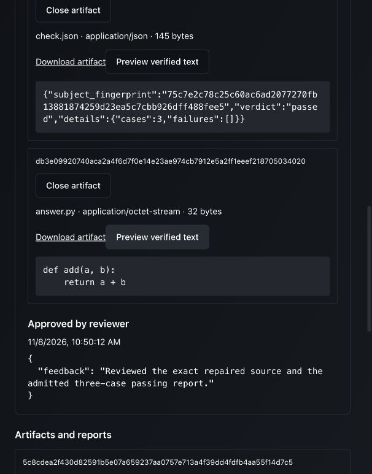

# UI-authored feature delivery and portable configuration

The actual App now configures a coding resource, designer and candidate Programs,
adopts their pinned revisions in Design/Engineering, and publishes a new Feature
Program. That authored root completes design revision, approval, coding, trusted
checks, repair, exact-evidence final review and retained artifact inspection.
Coding uses the production CLI adapter with a **controlled executable**, not a paid
provider. This is a functional authoring checkpoint, not final UX/remote acceptance.

## Changes and boundaries

- The editor exposes the existing application-owned validation endpoint through
  **Check readiness**. It saves well-formed unfinished work, displays version-bound
  issues, and withdraws the result on edits. Permission/placement admission and
  accepted-work evidence remain separate. No UI execution policy was introduced.
- Actual authoring found a portable identity defect: Codex configuration captures
  `timeout_seconds: 120.0`, but browser JSON serializes `120`. The unchanged bundle
  then failed its digest and could not be saved.
- Bundle format **2** normalizes whole-valued numbers only in hash input, preserving
  configuration types. Changed values, precision loss, unrelated resources and
  nonfinite numbers remain invalid. Format 1 is rejected; there is no legacy alias.
  This is a bounded numeric correction, not a claim of general JSON canonicalization.
- The controlled fixture now registers the production coding designer and supplies
  its saved coding resource. Operator policies, artifact services, trusted verifier
  and initial Design/Engineering definitions remain provided capabilities.
- The native TypeScript suite also exposed two ordinary-operation test graphs still
  using removed conversation channels. Those now bind directly from `input.name`.
  Intentional condition/MAS scenarios retain their explicit state contracts.

## Verification

```sh
.venv/bin/python -m pytest multi-agent/tests/domain multi-agent/tests/application multi-agent/tests/architecture -q
UNIFAI_TEST_MONGO_URI=mongodb://127.0.0.1:27018 UNIFAI_TEST_REDIS_URI=redis://127.0.0.1:6380/15 .venv/bin/python -m pytest multi-agent/tests/integration/ui/test_editor_client.py -k 'existing_typescript and programs' --ui-clients -q
UNIFAI_TEST_MONGO_URI=mongodb://127.0.0.1:27018 UNIFAI_TEST_REDIS_URI=redis://127.0.0.1:6380/15 .venv/bin/python -m pytest multi-agent/tests/integration/coding/test_feature_workflow.py -q
```

810 domain/application/boundary cases pass in 7.18s, including 12 bundle identity
regressions. The native production TypeScript Program suite passes in 9.74s:
capture/save/publication of the numeric Codex bundle succeeds and tampering rejects.
Both thread/process native feature workflows pass in 32.06s. UI typecheck/contracts
pass. Affected Python lint and strict typing for the domain module pass.

The actual App built with:

```sh
cd ui
NODE_ENV=production node tests/build-workspace-browser.mjs /tmp/unifai-feature-authoring-v2-assets-20261108
```

Existing vendor circular-chunk, mixed auth import and chunk-size warnings remain.
The focused browser fixture ran from the repository root:

```sh
UNIFAI_TEST_MONGO_URI=mongodb://127.0.0.1:27018 \
UNIFAI_TEST_REDIS_URI=redis://127.0.0.1:6380/15 \
PYTHONPATH=multi-agent/tests:multi-agent/lib:multi-agent/adapters:multi-agent:multi-agent/plugins \
.venv/bin/python -m support.feature_browser \
  --assets /tmp/unifai-feature-authoring-v2-assets-20261108 \
  --directory /tmp/unifai-feature-authoring-v2-run-20261108
```

MAS HTTP, signed cookies, Mongo, Redis, scoped capability provisioning and process
dispatch were real. External identity/settings and Codex behavior were controlled.
The normal `program@1` bridge used a separately owned trusted Python verifier;
Local evaluation was explicitly enabled only for controlled source.

## Actual browser journey

1. Create and publish **Authored designer** by capturing protected coding/loader
   bundles. Adopt its revision in Design and publish Design revision 2.
2. Create **Authored coding agent** through Resources, selecting saved workspace
   preparation, the synthetic fixture credential, model and process preference.
3. Create/publish **Authored coding candidate**, capturing that resource plus
   loader/reader/publisher, setting `answer.py` and explicit process placements.
4. Adopt that same candidate revision for Engineering implementation and repair;
   publish Engineering revision 2. Create **Authored feature delivery**, observe
   invalid readiness before child binding, bind both revision-2 dependencies,
   validate and publish. Edits invalidate earlier readiness reports.
5. Enter structured requirements/criteria and explicitly approve bounded artifact,
   review and verification scopes. Root `346e21b5-41b6-4c99-abe4-b425ceb124f6`
   executes those authored pins, not the fixture's prepublished Feature revision.
6. Reject design revision 1 with feedback; inspect and approve revision 2. Confirm
   planning ran but no implementation candidate existed before approval.
7. Observe two candidate calls: first trusted check fails, repair restores source
   and reports, second passes three cases. Preview the exact repaired source and
   admitted report while final review is pending, then approve.
8. Root returns `verified`. Mongo confirms exact pins/digests, two designer calls,
   two calls to the same candidate revision, three retired capability reservations,
   no remaining credential fields and no nonterminal execution records.
9. Delete only the terminal fixture's work/check workspaces. Fresh API and reloaded
   browser previews retrieve/hash-check source (32 bytes) and report (145 bytes).
   Close the tab; fixture exits 0, deleting its unique database and private cookie.

[Source, assets and execution identities](2026-11-08-feature-authoring-source.json)
record the exercised snapshot. An earlier failed-authoring fixture also shut down
normally before source changed; it never started a feature execution.



## Remaining acceptance

Rebuild receivers/images for bundle format 2 before remote gates. Earlier paid
Codex/OpenShell results retain their earlier source scope. This checkpoint does not
establish current-image live-provider authoring, hostile-code isolation, Temporal
recovery, full self-service policy setup, Session acceptance or final UX quality.
The current forms are an intermediate functional experience; coherent canvas,
contextual inspectors, inline controls and occurrence/attempt navigation remain
the dedicated UI milestone. The next product gate is bounded real-agent acceptance
of the authored path on matched infrastructure, without repeating unrelated matrices.
