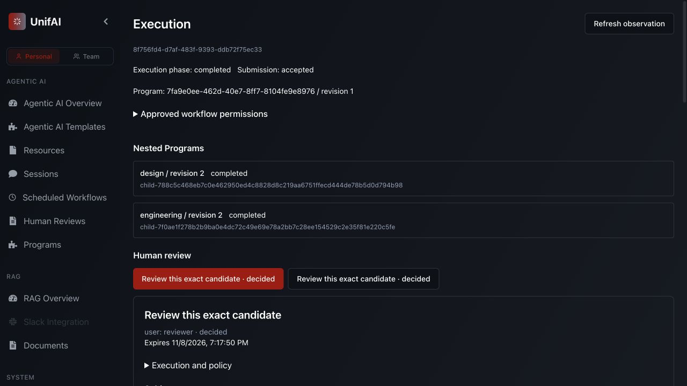
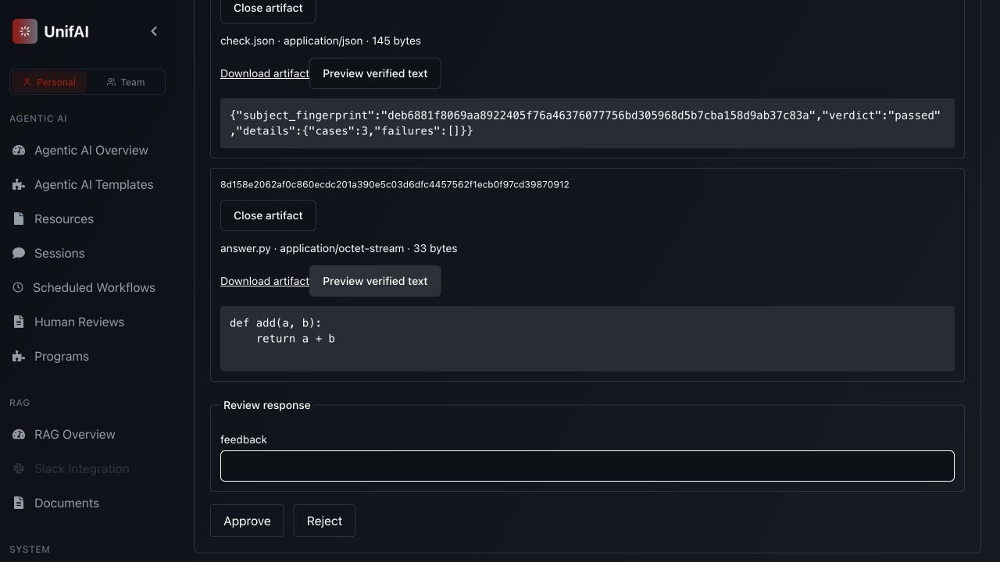
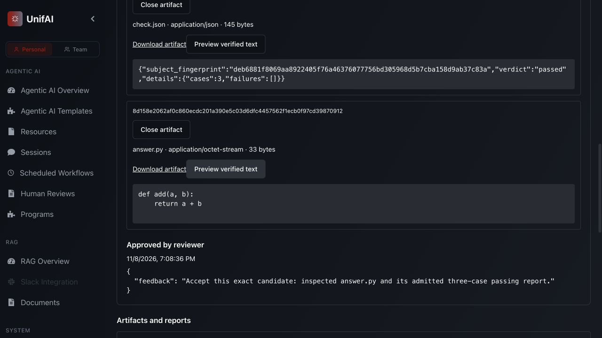

# UI-authored feature delivery with real Codex on OpenShell

The actual App now authors coding/designer resources and reusable Programs, adopts
their revisions in Design/Engineering, and completes an authored Feature root with
real planning and coding on matched OpenShell images. The human inspects the exact
source and admitted check report before approval. Both remain retrievable after
owned compute is deleted. This closes the thin first-product journey; it does not
complete the broader platform, final UX or operational matrices.

## Scope and ownership

- Real production App, signed-cookie HTTP, Mongo, Redis, protected resource capture,
  Program publication, managed capability consent, Run Engine Local coordination,
  Codex CLI 0.166.0 and `gpt-5.4-nano` provider calls.
- Separate authored designer/coder resources use normal factories and saved
  `inline_workspace` dependencies. Their API-key fields are empty. The private key
  is installed through the existing receiver-local test binding, never a portable
  definition or browser form. This is not automatic remote credential provisioning.
- Coding/designer/workspace-reader placement is `coding`, an externally provisioned
  fixture-owned normal OpenShell sandbox. Artifact operations use trusted `thread`
  placement. Input/output handoff is bounded content, without a storage credential
  on the coding receiver. API-host workspaces remain absent.
- A separately owned pinned Python verifier uses `evaluation`, a separate offline
  OpenShell sandbox. The comparison and evidence authority stay outside the evaluator.
  The candidate owner receives HTTP 403 on the private verifier execution.
- Production code and installed support sources stayed frozen from image verification
  through terminal execution and teardown. No Run Engine source was changed.

The only helper change allows terminal **UI-authored** Feature roots to release
fixture compute. It checks the authenticated root identity and terminal phase, then
the exact published `coding_feature@1` definition through the normal API. Active,
child, other-implementation and unauthorized requests are refused. This remains
test infrastructure, not a new execution or environment-management path.

## Build and verification

```sh
docker build --build-arg RECEIVER_BASE=ghcr.io/nvidia/openshell-community/sandboxes/base:latest --build-arg RECEIVER_USER=sandbox --build-context unifai="$PWD" --build-context run_engine="$PWD/../run-engine" --file multi-agent/tests/infra/Dockerfile.receiver --tag unifai-sandbox:feature-authoring-20261108 multi-agent/tests/infra
docker build --build-arg SANDBOX_IMAGE=unifai-sandbox:feature-authoring-20261108 --file multi-agent/tests/infra/Dockerfile.codex --tag unifai-codex:feature-authoring-20261108 multi-agent/tests/infra
.venv/bin/python multi-agent/tests/infra/verify_images.py --image unifai-sandbox:feature-authoring-20261108 --image unifai-codex:feature-authoring-20261108
.venv/bin/python -m pytest multi-agent/tests/adapters/test_live_browser_lifetime.py -q
```

Both builds succeed. Each image matches **1,403 Python files** from the current
Run Engine, shared utilities, platform and installed support sources; retired paths
are absent. Seven cleanup-guard cases pass in 0.76s; affected Ruff checks pass.
The production App build succeeds with the existing circular-vendor, mixed-auth-import
and chunk-size warnings. Its content hashes match the prior controlled authoring
App build; the frontend was not changed for this gate.

```sh
cd ui
NODE_ENV=production node tests/build-workspace-browser.mjs /tmp/unifai-live-authoring-assets-20261108
```

From the repository root, using the existing private provider binding:

```sh
UNIFAI_TEST_MONGO_URI=mongodb://127.0.0.1:27018 \
UNIFAI_TEST_REDIS_URI=redis://127.0.0.1:6380/15 \
UNIFAI_TEST_OPENSHELL_ENDPOINT=127.0.0.1:8090 \
UNIFAI_TEST_OPENSHELL_PKI="$PWD/multi-agent/tests/infra/.state/openshell-20261105/pki" \
UNIFAI_TEST_OPENSHELL_IMAGE=unifai-codex:feature-authoring-20261108 \
PYTHONPATH=multi-agent/tests:multi-agent/lib:multi-agent/adapters:multi-agent:multi-agent/plugins \
.venv/bin/python -m support.live_feature_browser \
  --assets /tmp/unifai-live-authoring-assets-20261108 \
  --directory /tmp/unifai-live-authoring-run-20261108 --backend openshell --live-coding
```

Existing gateway 0.0.103 is healthy with mTLS and unexpired certificates. No shared
service was restarted. Normal OpenShell uses best-effort Landlock on this host;
strict filesystem isolation is not claimed. The nested Codex sandbox mode is the
fixture's explicit `danger-full-access` inside outer OpenShell isolation. See the
[normal-profile limitations](2026-11-06-normal-openshell.md).

## Actual App journey

1. Create **Authored live coder** and **Authored live designer** in Resources:
   `gpt-5.4-nano`, low reasoning, 60-second timeout, four command events, isolated
   workspaces, saved workspace preparation, `coding` preference, no API key.
2. Create **Authored live designer program** using `coding_designer@1`. Capture the
   new designer and saved loader, choose coding/thread placement, check readiness,
   publish revision 1. Adopt it in Design and publish Design revision 2.
3. Create **Authored live candidate** using `coding_file_candidate@1`. Capture the
   new coder plus loader/reader/publisher, set `answer.py`, select coding/thread
   placement, validate and publish revision 1. Adopt that same revision for both
   Engineering implementation and repair; publish Engineering revision 2.
4. Create **Authored live feature**, pin Design/Engineering revision 2, validate,
   publish revision 1. Enter the small `add(a, b)` task and acceptance criteria.
   Explicitly approve review/verification/artifact scopes with 3,600-second leases,
   namespace bounds and a 65,536-byte artifact limit through normal UI fields.
5. Root `8f756fd4-d7af-483f-9393-ddb72f75ec33` starts only Design before approval.
   Actual planning completes; no candidate metadata exists. Inspect and approve the
   exact design revision 1. Only afterward does Engineering start.
6. Actual coding completes once. The independent offline check passes three cases;
   no live repair is needed. The [controlled authoring journey](2026-11-08-feature-authoring.md)
   separately covers rejected/revised design and failed-check repair.
7. Pending final review exposes `engineering-review@1`, the exact candidate and
   frozen accepted verification. Expand both artifact cards and fetch verified text
   previews. Read the source and passing report **before** clicking Approve.
8. The root returns `verified`. Native API/Mongo assertions validate the typed
   result, exact candidate/review/report identity, hashes/sizes, all five user-owned
   Program pins/digests and six completed executions including the private verifier.
   All three managed capabilities retire without credential fields or pending cleanup.
   Decoded source, report, public revisions/results and API log contain no private key.
9. Release only fixture-owned compute after root completion. Reload the actual App;
   reopen both cards and fetch previews again. Fresh HTTP downloads also verify
   source (33 bytes) and report (145 bytes) against their retained identities.







## Identity, cleanup and limits

[The source/image/asset manifest](2026-11-08-live-feature-authoring-source.json) records
exact hashes, pins, artifact identities, model bounds and cleanup evidence. Source
is `def add(a, b):\n    return a + b\n\n`; the trusted report records three cases and
no failures for that candidate fingerprint. These checks establish this small task,
not general task satisfaction, scalability or a reliability rate.

The browser tab closed; the same fixture exited 0. Its private cookie, API listener
52997, database `unifai_feature_browser_0649e3f66e0b4495ad50a54ce1a1673c`, workspace
`uf-1ef1615073cd` and recorded sandbox container `b147d46d2ccd` are confirmed absent.
Shared services remain running. The receiver images remain available for reuse.

This gate does not repeat unchanged independent/nested reuse, all recovery/backend
matrices, Temporal/Kubernetes, concurrent agents, full policy administration,
provider OAuth, Git/Jira/CI delivery, Session browser acceptance or the final canvas
UX. Prior evidence retains its recorded scope. No spending cap is inferred from
time/command limits. Next: configurable deliverable/acceptance/delivery capabilities
and larger intake-to-delivery composition, followed by the dedicated UI milestone.
