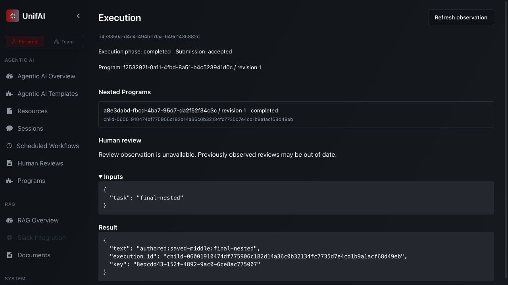

# Program authoring and draft lifecycle checkpoint

Scope: the actual App creates a saved operation resource, composes and publishes
a Program, executes it independently and unchanged as a pinned child, and keeps
published work runnable after incomplete draft edits. This closes a generic
authoring slice; it is not full feature-delivery or final canvas acceptance.

## Implementation and ownership

- `ProgramEditor` distinguishes Save from Publish. A named draft may omit graph
  endpoints or required configuration. Supplied invalid fields still block saving;
  publication requires complete form and authoritative application validation.
- `NumberField` keeps raw text separate from portable numeric data. `-`, `1e`,
  nonfinite values, wrong numeric types and supported range violations cannot
  silently save an old number or remove an optional setting. Shared invocation
  prevents discarding unparsed JSON/numbers by switching input views.
- `Programs` overrides the shared five-minute discovery cache for mutable drafts,
  waits for a fresh response on open, and retains editor identity across later
  observations. Explicit selection/reload owns replacement of editable state.
- These are UI presentation/edit-lifecycle changes. Server authorization, private
  configuration protection, draft version fences and immutable publication remain
  in the existing application pipeline. No engine, scheduler or parallel editor added.

## Verification

```sh
.venv/bin/python -m pytest multi-agent/tests/application/test_draft_validation.py -q
cd ui
npm run typecheck
npm run test:contracts
NODE_ENV=production node tests/build-workspace-browser.mjs /tmp/unifai-authoring-verified-assets-20261108
```

Eight backend draft cases pass. UI typecheck and contracts pass, including numeric
parsing/constraints and existing schema/graph/artifact/Session contracts. The App
bundle builds; existing circular vendor, mixed auth import and chunk-size warnings
remain. No remote image rebuild was necessary for these UI-only changes.

From repository root, the owned fixture used:

```sh
UNIFAI_TEST_MONGO_URI=mongodb://127.0.0.1:27018 \
UNIFAI_TEST_REDIS_URI=redis://127.0.0.1:6380/15 \
PYTHONPATH=multi-agent/tests:multi-agent/lib:multi-agent/adapters:multi-agent:multi-agent/plugins \
.venv/bin/python -m support.program_browser \
  --assets /tmp/unifai-authoring-verified-assets-20261108 \
  --directory /tmp/unifai-authoring-verified-run-20261108
```

The sandbox initially denied localhost sockets; the stopped attempt was replaced
with an approved localhost-enabled run. MAS HTTP, signed-cookie authentication,
Mongo, Redis and thread/process execution were real. External identity/settings
were fixture peers; operation behavior was deterministic, not a live coding agent.

Browser evidence, through normal controls without injected application state:

1. Save/reload an empty graph and a Wait missing its channel; publication refuses.
2. Malformed JSON blocks save; incomplete numeric text remains visible, blocks
   save/run/view-switch and retains the unsaved-change guard. Correct it, publish
   the same Wait and observe `timed_out`; correct typed invocation and observe total 6.
3. In Resources, create **Verified authored operation**, choose the saved middle
   dependency, prefix `authored:` and process placement. Add it to a named Program,
   bind `input.task` to `text`, capture dependencies, publish and run.
4. Create a parent on the canvas using that revision unchanged. Observe its actual
   child result and navigate into the child with parent/root links.
5. Save later drafts without start/finish, refuse publication, and run revision 1.
   Reopen within five minutes, save the next version and retain unsaved edits during
   library refresh. Explicit discard/reload restores the saved draft.

Intermediate probes found two bugs: optional number input removed its own field
when `-` was typed; cached draft reopening exposed an older source version. The
first cache guard also required `staleTime: 0` because selection changes reuse a
mounted observer. Both were corrected and their failing scenarios rechecked.
The final workspace bundle rechecked cached reopen/save/run/reopen and dirty-edit
retention; the earlier numeric/schema implementation was unchanged by that correction.

Mongo assertions confirmed one immutable revision, three captured resources,
process placement and identical child/standalone/post-edit content digests. See
[source/assets and execution identities](2026-11-08-program-authoring-source.json).
All observed executions were terminal before cleanup. Each owned fixture stopped
with exit 0 and removed its unique database; tabs closed and shared services remained.



## Limits and next work

Reviews are disabled in this generic fixture; the UI truthfully reports unavailable
review observation. This does not replace the separate final-review evidence proof.
No paid provider, OpenShell, Kubernetes, Temporal recovery or complete Session/browser
acceptance was exercised. Full coding-resource/design/Engineering authoring, actual
feature delivery through that authoring path, inline controls, rich live nested
canvas, occurrence/attempt views and visual/accessibility refinement remain required.
