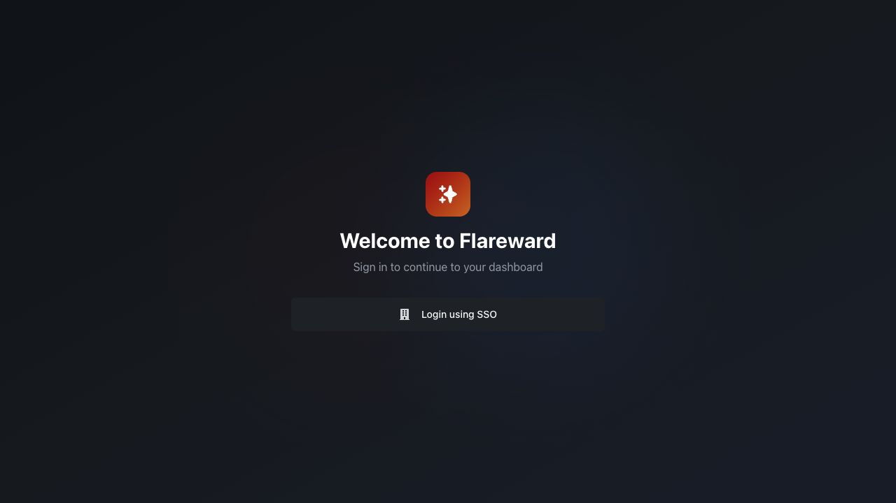

# Flareward product, package and plugin naming cutover

Date: 2026-11-09. The user selected Flareward and requested the naming change
throughout the platform, then explicitly selected `plugins` as the implementation
namespace. This task preserves the previous uncommitted repository reorganization
and feature work. No staging, commit, push or external repository rename occurred;
the larger ADLC goal remains paused.

## Current names and ownership

- Product/readmes/UI/API descriptions: **Flareward**.
- Core: `platform/src/flareward`, import `flareward.*`.
- Capability implementations: `platform/src/plugins`, import `plugins.*`.
  The pure manifest contract stays in core `flareward.plugins`; bootstrap selects
  the existing 23 capability manifests. No second registry or runtime was added.
- Distribution/entry point: `flareward-platform`; developer tooling `flareward-dev`;
  UI package `flareward-ui`; application/test settings `FLAREWARD_*`.
- Runtime contract markers, secret-reference schemes, wire labels, default database,
  queues, images, release/chart/storage names and generated test identities now use
  Flareward. Python imports/discovery, tests, Docker inputs, charts, developer/CI
  tooling and active instructions were updated together.
- The root README, target architecture, development/status/plan, package readmes
  and owned test skills describe these names. Identity diagram filenames were
  renamed. Existing captures retain their historical contents.

[Migration and external identities](../branding.md) explains fresh publications,
matched API/worker/receivers, new configuration names and explicit data locations.
Old package aliases are absent. Existing data, grants, histories and infrastructure
are not rewritten or deleted. External GitHub/Vault/Jenkins/support identities keep
their real addresses; a source rename cannot provision replacements for them.

## Verification

- Platform domain/application/architecture/adapters/catalog plus developer tools:
  **1,350 passed** after the final `plugins.*` cutover.
- Native integration and actual TypeScript clients: **709 passed** in 809.57
  seconds, selecting all `platform/tests/integration` except deployment with
  `--ui-clients` and explicit dedicated Mongo/transaction Mongo/Redis/Temporal URIs.
- Identity: **22 passed, 1 skipped** (explicit optional smoke case).
- UI static types, actual graph/session contract runner and production build pass.
  The existing bundle-size warning remains.
- Ruff import/undefined-name/syntax checks and formatting pass across platform
  source/tests; Python compilation passes. Workflow/chart/service YAML parses
  (22 files), retained shell syntax passes, and `git diff --check` is clean.
- Installed CLI help, renamed settings, all 23 plugin manifests and absence of
  old Python namespaces/console entry point were checked directly.
- Rebuilt production image: **1,302 installed Python files match**. CLI/HTTP
  publication/native Wait/shutdown pass on Local and with a separate actual
  Temporal worker. The temporary worker is removed.
- Rebuilt Kubernetes and normal OpenShell receivers: **1,418 installed source and
  fixture files match in each**; retired namespaces are absent.
- Focused remote gate: **16 passed, 24 deselected** in 125.25 seconds. The selector
  covers custom per-call placement (ordinary/retained), graph/backend/child-graph
  composition and child-owned environment release while the parent continues,
  across Local/Temporal x Kubernetes/OpenShell. It verifies native replay and
  physical cleanup. No test namespaces remain.

The initial sandboxed regression attempt passed 1,345 tests but blocked five local
socket tests with OS permission errors. The full permitted run above passed; no
application changes were made to hide those restrictions.

## UI observation

The actual production build displays document title `Flareward`, heading
`Welcome to Flareward` and the existing SSO action. This branding-only browser
check uses a temporary signed-out identity response, no SSO login or credentials.
It is distinct from native API-client integration. The preview, identity fixture
and browser tab were closed afterward.

## Build and infrastructure identities

Run Engine is unchanged at `60393440efd3876cd6c81e0b013e8bf6d9167659`.

| Image | Identity |
| --- | --- |
| `flareward-platform:rename-20261109` | `sha256:e0be868d3edb8456c2912dbfc9eb62ae838b202c9e06ca5a28cfbda116b59eac` |
| `flareward-receiver:rename-20261109` | `sha256:dfc0d4c385352885f616e936791a288f9b1521ee6ee77ef657c88661ade6ddd8` |
| `flareward-sandbox:rename-20261109` | `sha256:796993f5fceedd53363db57e199e25993dd5c1626a452d1e784a63f78ed5d10b` |

The dedicated Compose project and kind cluster are `flareward-e2e`, with private
state/kubeconfig under `platform/tests/infra/.state/rename-20261109`. Mongo 27018,
transaction Mongo 27019, Redis 6380, Temporal 7234 and mTLS OpenShell 8090 belong to
this stack. TLS and client authentication remain enabled; normal OpenShell uses
its supported policy. Existing projects/clusters and global Kubernetes context
were not changed. Reusable Flareward services remain available; scenario-owned
API/worker/storage/workspace/namespace resources are cleaned by the harness.

No paid model calls, live delivery, external deployments, UI/Identity image builds,
Codex-image rebuild or strict Landlock acceptance were selected for this naming
milestone. Prior broader acceptance limitations remain in the plan. Passing this
gate is not completion of the full ADLC platform objective.

See the [source manifest](2026-11-09-flareward-rename-source.json).
