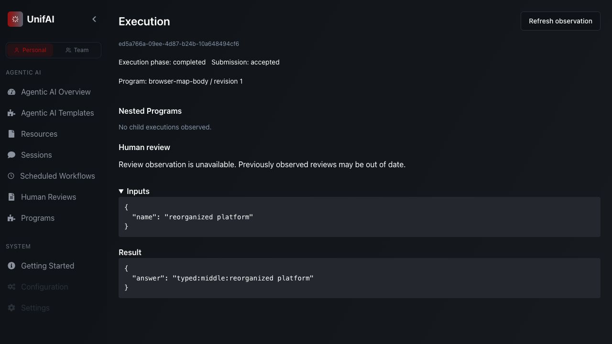

# Feature-owned repository and plugin cutover

Date: 2026-11-09. This closes the user's explicit repository reorganization task,
not the paused overall ADLC objective. Existing uncommitted feature/Git work was
preserved; no staging, commit or push was performed. Historical evidence remains
snapshot-specific and intentionally retains original paths and hashes.

## Result and ownership

- `multi-agent` becomes `platform`, with one `src/` package root: `unifai` core and
  `unifai_plugins` capability contributions. There are no compatibility imports.
- Core features own their domain values, ports, services and adapters locally.
  API/bootstrap are explicit outer boundaries. Vendor agent/model/tool adapters,
  Git/ADLC compositions, review/check/artifact operations and reusable Programs
  live in capability plugins. Only bootstrap selects concrete installed plugins.
- `PluginDefinition` describes installed Element/Program/graph-validator modules;
  bootstrap uses the existing Element catalog, category builders, factories and
  Program registry. It does not introduce another behavior registry or scheduler.
- Generic operation/construction and agent behavior remain independent of graph
  state. Graph-node adapters explicitly opt into graph contracts. Generic graph
  data uses `input/results/values/output`; conversation Sessions are explicit.
- Identity moves to `identity`; shared infrastructure helpers to
  `packages/service-support`; deployment to `infra/helm`; developer/CI tooling to
  `tools`. `ui` retains its name, React Flow canvas and shared execution experience.
- Removed bundled RAG ingestion, separate admin backend, product CLI, generated
  obsolete service maps, old Flask/custom/LangGraph platform execution, singleton
  composition, unused old Session/scheduler facades and dead sync admin readers.
- Preserved useful agent behavior, factories/specifications, resource dependencies,
  templates, scheduling/sharing services, optional external async Slack retrieval
  (explicit endpoint required), Git candidates, checks, review and artifact flows.
- Administration and transparency consent now use native platform services, typed
  schemas, authenticated-human authority and durable Mongo storage. Configuration
  edits use revision CAS; consent is versioned/idempotent. UI clients use `/api`;
  Identity uses `/identity/api`. Server-managed editor hints live in the inbound
  resource presenter, outside the persisted Resource domain model.
- Package discovery, worker portable imports, images, API clients, proxy routes,
  deployment groups, developer commands and current documentation/skills use the
  new layout. Removed app charts/hooks/dependencies are not retained.

## Verification

| Gate | Result and scope |
| --- | --- |
| Before-change baseline | 1,054 domain/application/architecture/adapter tests passed. |
| Final baseline + catalog | 1,098 passed; includes 16 feature/plugin/domain/cold-import guards and actual manifest contribution discovery. |
| Broad native investigation | 1,727 passed, 23 failed, 11 skipped. Failures exposed stale namespace/graph/Session fixtures, retired RAG probes and misplaced editor metadata. This initial run is not claimed green. |
| Focused repairs | All 33 coding/artifact/repository/agent/MCP/blueprint/editor/provider/Temporal cases passed after correction; discovery's 11 cases also passed and are included in the final baseline/catalog gate. Tests use canonical generic graph inputs or explicit conversation; contracts were not weakened. |
| Production UI clients | 11 passed, one blueprint-client failure, one explicit skip; repaired blueprint-client case passed separately. Includes signed-human reporting, resources, Programs, Sessions, sharing/reviews and migrated admin/consent with real stores. |
| New administration | Concurrent first-write conflict, schema refusal, actor scope, consent separation/idempotence, API restart and real TypeScript clients pass. |
| Developer tooling | 252 passed, including owned loopback checks. |
| Identity | 22 passed, one opt-in service smoke skipped; stale unit infrastructure/session-key fixtures corrected to current contracts. |
| Static | Full platform source import/syntax/undefined-name checks and formatting pass; new plugin/admin/consent code passes strict mypy (16 files). Final UI TypeScript, contract suite and production build pass. |
| Actual App | Opened saved graph on React Flow canvas, executed a published revision and observed `typed:middle:reorganized platform` in the shared execution workbench. Deterministic operation, actual native API/process runner; external identity is an owned test peer. |
| Production image | 1,302 installed Python sources match; old namespaces absent. Canonical CLI/API/publication/native Wait/shutdown passes on Local and with a separately started actual Temporal worker. |
| Remote images | Both images match 1,418 installed source/fixture files; Kubernetes image loaded into dedicated `unifai-e2e` cluster. |
| Actual remote execution | 20 passed, 20 deselected: Local/Temporal × Kubernetes/normal OpenShell, profile/named-environment operation placement, graph -> backend Program -> remote child graph, parent environment borrowing and child-owned environment release while parent continues. Includes native replay, receiver identity and physical cleanup assertions. |

Production image: `unifai-platform:layout-20261109`,
`sha256:ba63a7aa5d1345932bb5e0a7a43e51746bcf41bb03a5365ab44ab25f2e2bd692`.
Receiver: `unifai-receiver:layout-20261109`,
`sha256:12e50e46bf14909de6990dab419fe16f8d4f67a7252185e7e62a7cec6052b3ca`.
Sandbox: `unifai-sandbox:layout-20261109`,
`sha256:da4a3eaa07ba60c8f0235e559b6c392a09848db79274357ccfcc469eb466f6f2`.

Run Engine remains unchanged at `60393440efd3876cd6c81e0b013e8bf6d9167659`.
See [source manifest](2026-11-09-repository-structure-source.json),
[setup](../../platform/README.md) and [test infrastructure](../../platform/tests/infra/README.md).

## Infrastructure and limits

The dedicated idle OpenShell gateway was recreated with fresh mTLS identities and
its new absolute state path (`platform/tests/infra/.state/layout-20261109`). TLS,
client authentication and normal sandbox policy remain enabled. No unrelated
containers were stopped. Owned test APIs/workers/databases/namespaces/workspaces
were cleaned up; dedicated reusable services remain available. No paid calls ran.

This is representative current-source remote acceptance, not the full adverse,
load, private-delivery or paid-Codex/provider matrix. All four previously unreached
child-owned host/backend combinations now pass. Broader recovery/control/product
obligations remain in the plan. External Jenkins/GitHub/cluster chart deployment
was not executed; production deployment is not certified. UI build still reports
large bundle chunks. Final UX redesign and full goal completion remain open.

